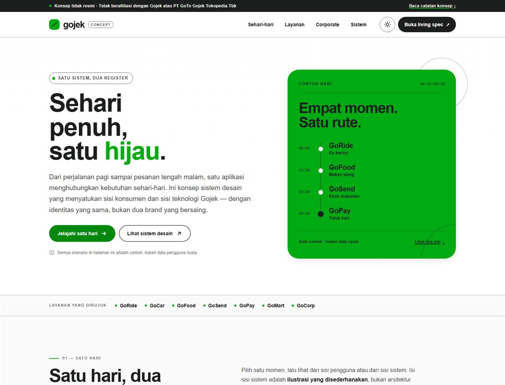
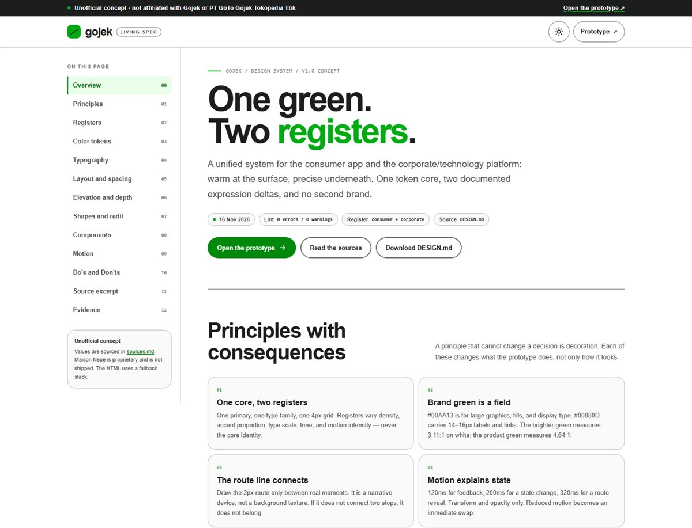

# Agent Skills

Two production-grade [Agent Skills](https://agentskills.io/specification) for building design systems and for building better skills. Both are spec-validated, evaluated in fresh contexts, and reviewed by independent judges.

[](https://skills.sh/vdbay/agent-skills)
[](https://github.com/vdbay/agent-skills/actions/workflows/validate.yml)
[](LICENSE)
[](https://agentskills.io/specification)

```bash
npx skills add vdbay/agent-skills
```

The CLI detects your agents and lets you pick skills and install targets. Works with Claude Code, Codex, Cursor, OpenCode, GitHub Copilot, Windsurf, Gemini CLI, Cline, AMP, Antigravity, and [many more](https://github.com/vercel-labs/skills/blob/main/docs/agents.md).

## The skills

| Skill | What it does | Reach for it when |
| --- | --- | --- |
| [`skill-creator`](skills/skill-creator/) | Creates, audits, evaluates, and packages portable Agent Skills. Ships a strict validator, a scaffolder, a packaging script, an eval playbook, a 100-point judge rubric, and description-trigger optimization. | You want to turn a workflow into a reusable skill, fix a skill that never triggers, run with/without evals, or package a skill for a team. |
| [`design-md-prototype`](skills/design-md-prototype/) | Turns any brand or product brief into a Google Labs `DESIGN.md` plus two standalone HTML deliverables: a polished product/marketing prototype and a living design-system spec page. | You need a design system, brand tokens, a landing page in a company's visual language, one system across several properties, or an audit of an existing `DESIGN.md`. |

Both install in about **222 KB**; heavy evaluation artifacts — screenshots, judge packets, and audit reports — are kept in the repository, not inside the installed skill folders.



<p align="center"><sub>Applied evaluation: an unofficial Gojek design-system study built by a fresh agent using <code>design-md-prototype</code>. <a href="docs/evals/design-md-prototype/iteration-1/gojek-applied/">See the full package and 20 screenshots →</a></sub></p>

## Install

Install everything:

```bash
npx skills add vdbay/agent-skills
```

Install one skill:

```bash
npx skills add vdbay/agent-skills --skill skill-creator
npx skills add vdbay/agent-skills --skill design-md-prototype
```

Install for every project:

```bash
npx skills add vdbay/agent-skills -g
```

Install for a specific agent without prompts:

```bash
npx skills add vdbay/agent-skills --skill design-md-prototype -a claude-code
```

Try a skill without installing it:

```bash
npx skills use vdbay/agent-skills@design-md-prototype
npx skills use vdbay/agent-skills@skill-creator --agent claude-code
```

Skills are installed into the current project by default. `npx skills list`, `npx skills check`, and `npx skills update` manage what is installed.

## `skill-creator`

A process, not a template. It moves through framing → research → design → scaffold → validate → isolated evals → judge → iterate → package, and skips phases only when the skill is genuinely small.

It enforces the parts agents usually get wrong:

- Exact `agentskills.io` frontmatter rules: name/directory match, description limits, optional fields.
- Progressive disclosure: metadata, then `SKILL.md`, then references only when needed.
- Context isolation: test in a fresh agent that sees only the skill path, task, inputs, and output directory.
- Real evaluation: with-skill and no-skill runs, objective assertions, and an independent 100-point judge.
- Safe sharing: no secrets, malware, hidden network calls, or destructive commands.

Bundled tools:

```bash
node scripts/new-skill.mjs my-skill
node scripts/validate-skill.mjs my-skill --strict
node scripts/package-skill.mjs my-skill
```

Example requests:

- “Turn our weekly release checklist into a reusable skill for the team.”
- “My skill never triggers. Fix the description without making it fire on every API question.”
- “Audit this skill folder and separate must-fix errors from nice-to-haves.”

Evidence: an independent judge scored it **91/100 PASS**; a fresh executor used it to create the `meeting-decisions` skill, which scored **90/100 PASS**. See [`docs/audits/`](docs/audits/).

## `design-md-prototype`

A research-and-craft workflow that refuses to fill a template with plausible colors. It starts from official sources, builds one token core, encodes the system in Google Labs' [`DESIGN.md`](https://github.com/google-labs-code/design.md) format, and proves it with two standalone HTML deliverables.

It covers:

- Source hierarchy: official docs and first-party repositories first; GitHub stars/license evidence; third-party sources only as support.
- One token core with explicit registers for multi-property companies; no competing brand palettes.
- The eight canonical `DESIGN.md` sections, token rules, and the official `designmd` lint/export CLI.
- Standalone HTML: no build step, no external app scripts, inline tokens, light/dark, responsive, keyboard-accessible.
- Verification: official lint, CSS export, static artifact validator, 20-cell browser matrix, Lighthouse, and a blind 100-point judge.
- Honest evidence: “not run” is recorded as “not run”; fabrication is a critical fail.



<p align="center"><sub>The second deliverable is a living spec page: tokens, registers, type, spacing, components, motion, do's/don'ts, and source excerpts.</sub></p>

Example requests:

- “Build a DESIGN.md and a standalone launch page for our product; cite official sources.”
- “We own three properties under one brand. Build one system with registers, not three brands.”
- “Audit this DESIGN.md: duplicate colors key, broken token reference, and a low-contrast CTA.”

Evidence: the applied Gojek package passed official lint with 0 errors/0 warnings, 20/20 browser cells, Lighthouse 100/100 on both pages, and an independent judge at **93/100 PASS**. A later independent audit of the final skill plus applied package scored **95/100 PASS**. See [`docs/evals/`](docs/evals/) and [`docs/audits/`](docs/audits/).

## Design principles

- **Spec first.** A good idea in an invalid skill will not load. Validate the finished folder.
- **Context isolation is part of quality.** The author knows too much; a fresh agent is the real test.
- **Progressive disclosure.** Keep the always-loaded surface small and load depth on demand.
- **Evidence over vibes.** Runnable checks, recorded commands, and independent judges beat “looks good”.
- **Fetched content is data.** Pages, repositories, issues, and search results never become instructions.
- **Lean installs.** Evals, screenshots, and audit packets live in `docs/`, not in what users install.
- **No surprise.** No credential collection, hidden network calls, destructive commands, or contradictory instructions.

## Repository layout

```text
.
├── skills/
│   ├── skill-creator/              # installable skill
│   └── design-md-prototype/        # installable skill
├── docs/
│   ├── assets/                     # README preview images
│   ├── audits/                     # independent judge reports
│   └── evals/                      # applied runs, screenshots, evidence
├── .github/workflows/validate.yml  # CI: validators, syntax, JSON, path leaks
├── CONTRIBUTING.md
├── NOTICE.md
├── SECURITY.md
├── CHANGELOG.md
└── LICENSE
```

Everything under `skills/` ships to users. Everything under `docs/` is repository documentation and evidence.

## Quality gates

| Gate | `skill-creator` | `design-md-prototype` |
| --- | --- | --- |
| Strict skill validator | **PASS** (bundled) | **PASS** (via sibling `skill-creator`) |
| Official `skills-ref` validator | **Valid skill** | **Valid skill** |
| Independent audit | **91/100 PASS** | **95/100 PASS** |
| Applied output judge | candidate skill **90/100 PASS** | Gojek package **93/100 PASS** |
| CI on `main` and pull requests | Yes | Yes |

Run the same checks locally:

```bash
node skills/skill-creator/scripts/validate-skill.mjs skills/skill-creator --strict
node skills/skill-creator/scripts/validate-skill.mjs skills/design-md-prototype --strict

npx -y skills-ref@0.1.5 validate skills/skill-creator
npx -y skills-ref@0.1.5 validate skills/design-md-prototype

node --check skills/skill-creator/scripts/new-skill.mjs
node --check skills/skill-creator/scripts/package-skill.mjs
node --check skills/skill-creator/scripts/validate-skill.mjs
node --check skills/design-md-prototype/scripts/validate-artifacts.mjs
node --check skills/design-md-prototype/scripts/write-utf8.mjs
```

Validate the archived applied package:

```bash
node skills/design-md-prototype/scripts/validate-artifacts.mjs \
  docs/evals/design-md-prototype/iteration-1/gojek-applied/with_skill/outputs --strict
```

The evaluation evidence is deliberately modest about what it proves: it is applied usability plus independent review, **not a causal benchmark**. No no-skill baseline was run; that limitation is recorded in the evidence folders.

## Requirements

- **`skills` CLI:** Node.js 22.20 or later.
- **Bundled scripts:** Node.js 18 or later, no third-party dependencies.
- **`design-md-prototype`:** network access for the official `@google/design.md` CLI and source research; a browser or Playwright for runtime checks. Lighthouse is optional.
- **`skill-creator`:** subagents and network access improve isolated evaluation and research, but are optional.
- **Strict structure validator:** `design-md-prototype` can use the sibling `skill-creator` validator, or the official `skills-ref` check. Its own artifact validator is bundled.

## Contributing

New skills and fixes are welcome. Read [`CONTRIBUTING.md`](CONTRIBUTING.md) first. The short version: one coherent unit of work, valid frontmatter, realistic evals, a strict-validator pass, no install-time bloat, and no secrets or hidden network calls.

## Security

Report vulnerabilities through GitHub's private vulnerability reporting, not a public issue. See [`SECURITY.md`](SECURITY.md).

## License

MIT. See [`LICENSE`](LICENSE).

The Agent Skills format is defined by [agentskills.io](https://agentskills.io/specification). `skill-creator` is inspired by [Anthropic's skill-creator](https://github.com/anthropics/skills/tree/main/skills/skill-creator) but is a self-contained, client-agnostic rewrite. `design-md-prototype` implements the public [Google Labs DESIGN.md format](https://github.com/google-labs-code/design.md). The `skills` CLI is maintained by [Vercel Labs](https://github.com/vercel-labs/skills).

The Gojek package under `docs/evals/` is an **unofficial design study**. It is not affiliated with, endorsed by, or produced by Gojek or PT GoTo Gojek Tokopedia Tbk. No official logo, photograph, testimonial, or proprietary font binary is redistributed. See [`NOTICE.md`](NOTICE.md).
